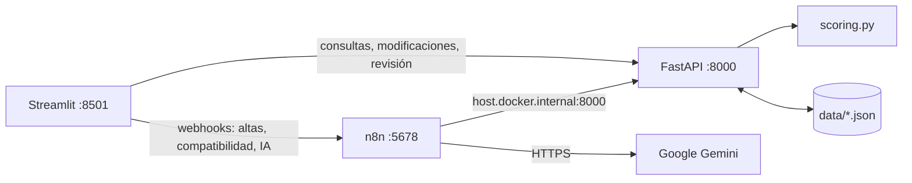

# Nextia

Plataforma de vinculación y desarrollo profesional entre estudiantes, graduados y organizaciones que ofrecen oportunidades laborales.

Nextia registra perfiles y ofertas, calcula su compatibilidad mediante reglas explícitas en Python y puede generar recomendaciones de formación con IA. El cálculo del score es determinista; las recomendaciones generadas por IA requieren revisión humana.

## Funcionalidades

- Registro, consulta y modificación de estudiantes, competencias y ofertas laborales.
- Cálculo del score de compatibilidad y detección de competencias faltantes.
- Consulta del diagnóstico técnico y del historial de compatibilidades.
- Generación y consulta de recomendaciones personalizadas mediante Google Gemini y n8n.
- Revisión humana de las recomendaciones: cada una nace `pendiente` y una persona la aprueba o la rechaza desde la pestaña **Recomendaciones IA**, dejando su nombre y un comentario.
- Workflows de n8n para registrar estudiantes y ofertas, calcular compatibilidades y generar recomendaciones.

## Componentes y flujo de datos

| Componente | Tecnología | Responsabilidad |
|---|---|---|
| Interfaz | Streamlit | Formularios, diagnósticos, recomendaciones y tablas. Se comunica con FastAPI y con los webhooks de n8n. |
| API | FastAPI | Valida datos, aplica la lógica de negocio y guarda y consulta información. |
| Lógica | Python | Calcula el score y detecta competencias faltantes. |
| Persistencia | Archivos JSON | Almacena estudiantes, ofertas, resultados y recomendaciones en `data/`. |
| Automatización | n8n | Expone webhooks, llama a FastAPI y coordina la generación de recomendaciones. |
| IA | Google Gemini | Genera recomendaciones a partir de resultados calculados por Nextia. |



El diagrama completo, los puertos, la tabla de comunicación entre componentes y el recorrido del proceso principal están en [`docs/arquitectura.md`](docs/arquitectura.md).

## Requisitos

Para ejecutar todo el sistema con Docker:

- Git
- Docker con Docker Compose (en Windows, Docker Desktop)
- Una API key gratuita de Google Gemini, que se obtiene en https://aistudio.google.com/apikey con una cuenta de Google. Solo es necesaria para el workflow de recomendaciones con IA.

Para ejecutar FastAPI y Streamlit localmente:

- Python 3.10 o superior
- Git
- Dependencias de `requirements.txt`

## Instalación

Clona el repositorio y entra en su directorio:

```bash
git clone <URL_DEL_REPOSITORIO>
cd nextia
```

Para la ejecucion local, crea y activa un entorno virtual e instala las dependencias:

```powershell
python -m venv .venv
# Windows PowerShell
.\.venv\Scripts\Activate.ps1
pip install -r requirements.txt
```

En macOS o Linux, activa el entorno con:

```bash
source .venv/bin/activate
```

## Ejecución

### Opción 1: sistema completo con Docker Compose

Desde la raiz del proyecto, inicia FastAPI, Streamlit y n8n:

```bash
docker compose up -d
```

Accesos locales:

| Servicio | URL |
|---|---|
| Streamlit | http://localhost:8501 |
| FastAPI y documentacion Swagger | http://localhost:8000/docs |
| n8n | http://localhost:5678 |

En esta configuración, Streamlit accede a FastAPI mediante `http://api:8000` y a n8n mediante `http://n8n:5678/webhook`. n8n accede a FastAPI mediante `http://host.docker.internal:8000`. Los datos JSON se conservan en `data/` y n8n conserva su estado en un volumen de Docker.

Comandos utiles:

```bash
docker compose ps
docker compose logs -f
docker compose logs -f api
docker compose logs -f streamlit
docker compose logs -f n8n
docker compose restart
docker compose down
```

### Opción 2: desarrollo local con n8n en Docker

Inicia solamente n8n desde la raiz del proyecto:

```bash
docker compose -f n8n/compose.yaml up -d
```

En terminales separadas, activa el entorno virtual en cada terminal y ejecuta la API y la interfaz:

```powershell
# Terminal 1: API
.\.venv\Scripts\Activate.ps1
python -m uvicorn app.main:app --reload
```

```powershell
# Terminal 2: Streamlit
.\.venv\Scripts\Activate.ps1
python -m streamlit run interfaz/streamlit_app.py
```

La API queda disponible en http://127.0.0.1:8000 y Streamlit en http://localhost:8501. La documentación de la API se encuentra en `/docs`.

Si n8n no logra conectarse con la API, iníciala con `--host 0.0.0.0` para que acepte conexiones desde el contenedor.

Por defecto, Streamlit busca la API en `http://127.0.0.1:8000` y n8n en `http://127.0.0.1:5678/webhook`. Si algún servicio corre en otro puerto, cambia las direcciones con las variables `API_URL` y `N8N_URL` antes de iniciar Streamlit:

```powershell
$env:API_URL = "http://127.0.0.1:8001"
$env:N8N_URL = "http://127.0.0.1:5678/webhook"
```

En macOS o Linux, activa el entorno en cada terminal con `source .venv/bin/activate`.

## Workflows de n8n

Los cuatro workflows se encuentran en `n8n/`:

| Workflow | Archivo | Responsabilidad |
|---|---|---|
| Alta automatizada de estudiantes | `n8n/alta-estudiantes.json` | Valida y registra un estudiante mediante FastAPI. |
| Compatibilidad automática | `n8n/compatibilidad-automatica.json` | Valida los identificadores, calcula la compatibilidad y guarda el resultado. |
| Recomendaciones con IA | `n8n/recomendaciones-ia.json` | Obtiene un resultado, consulta Gemini y guarda la recomendación. |
| Alta automatizada de ofertas | `n8n/alta-ofertas.json` | Valida y registra una oferta mediante FastAPI. |

Para usarlos:

1. Inicia n8n con una de las opciones de ejecución anteriores.
2. Abre http://localhost:5678 y selecciona **Workflows > Import from File**.
3. Importa los archivos JSON desde `n8n/`.
4. Guarda y **publica** cada workflow con **Publish**. Los webhooks usan la versión publicada: guardar no alcanza. Si n8n lo muestra inactivo después de importarlo o reiniciarlo, actívalo desde la interfaz.
5. Configura la credencial de Gemini para el workflow de recomendaciones (ver abajo).

**Configurar la credencial de Gemini** (una sola vez, porque queda guardada en el volumen de n8n):

1. Abre el workflow **Recomendaciones IA**.
2. Abre el nodo **Google Gemini Chat Model** y elige *Credential* → *Create new credential*.
3. Pega la API key en *API Key*, deja el *Host* por defecto y guarda.
4. **Publica** el workflow. Si no lo publicas, sigue usando la credencial del archivo importado y falla con `CredentialNotFoundError`.

La API key nunca se sube al repositorio: n8n la guarda cifrada en su volumen y los workflows exportados solo guardan una referencia a la credencial.

**Configuración de n8n en Docker** (igual en `compose.yaml` y en `n8n/compose.yaml`):

| Elemento | Valor | Para qué |
|---|---|---|
| Imagen | `docker.n8n.io/n8nio/n8n:2.46.6` | Versión fija, para que todo el grupo use el mismo n8n |
| Contenedor | `nextia-n8n` | Nombre para `docker logs nextia-n8n` o `docker exec` |
| Puerto | `5678:5678` | Editor web y webhooks |
| `extra_hosts` | `host.docker.internal:host-gateway` | Permite que n8n llegue a la API publicada en el equipo anfitrión |
| Volumen | `n8n_data:/home/node/.n8n` | Conserva workflows, credenciales y usuario entre reinicios |
| Zona horaria | `America/Argentina/Buenos_Aires` | Fechas de ejecución correctas |

Las dos configuraciones usan el mismo nombre de contenedor, así que no pueden correr a la vez. Además, cada una tiene su propio volumen: los workflows y credenciales importados en una no aparecen en la otra.

Si se actualiza la versión de la imagen, hay que descargarla y recrear el contenedor con `docker compose pull` y `docker compose up -d`.

Los workflows llaman a FastAPI mediante `http://host.docker.internal:8000`. Devuelven errores HTTP 400 o 404 para solicitudes inválidas. Si modificas un workflow en n8n, vuelve a exportarlo para actualizar el archivo versionado.

### Registrar un estudiante

Webhook: `POST /webhook/registrar-estudiante`

```json
{
  "nombre": "Ana López",
  "carrera": "Analista de Sistemas",
  "competencias": ["python", "sql", "git"]
}
```

El workflow valida que nombre, carrera y competencias estén presentes. Si la solicitud es válida, llama a `POST /estudiantes` y devuelve el estudiante creado.

Prueba desde PowerShell:

```powershell
$body = @{
  nombre = "Ana López"
  carrera = "Analista de Sistemas"
  competencias = @("python", "sql", "git")
} | ConvertTo-Json

Invoke-RestMethod `
  -Uri "http://localhost:5678/webhook/registrar-estudiante" `
  -Method Post `
  -ContentType "application/json" `
  -Body $body
```

### Calcular compatibilidad

Webhook: `POST /webhook/calcular-compatibilidad`

```json
{
  "estudiante_id": 1,
  "oferta_id": 1
}
```

El workflow valida que ambos identificadores estén presentes y llama a `POST /compatibilidad`. FastAPI calcula el score, identifica las competencias faltantes y guarda el resultado.

Prueba desde PowerShell:

```powershell
$body = @{
  estudiante_id = 1
  oferta_id = 1
} | ConvertTo-Json

Invoke-RestMethod `
  -Uri "http://localhost:5678/webhook/calcular-compatibilidad" `
  -Method Post `
  -ContentType "application/json" `
  -Body $body
```

### Generar una recomendación con IA

Webhook: `POST /webhook/generar-recomendacion`

```json
{
  "resultado_id": 9
}
```

El workflow obtiene el resultado mediante `GET /resultados/{id}` y verifica que exista. Luego envía el score y las competencias faltantes a Google Gemini mediante un `Basic LLM Chain` y guarda la respuesta con `POST /recomendaciones` y `modelo: "gemini"`.

Prueba desde PowerShell:

```powershell
$body = @{
  resultado_id = 9
} | ConvertTo-Json

Invoke-RestMethod `
  -Uri "http://localhost:5678/webhook/generar-recomendacion" `
  -Method Post `
  -ContentType "application/json" `
  -Body $body
```

La API identifica estas respuestas como `generado por IA (requiere revisión humana)`.

### Registrar una oferta

Webhook: `POST /webhook/registrar-oferta`

```json
{
  "titulo": "Desarrollador Junior",
  "empresa": "Empresa NextIA",
  "requisitos_obligatorios": ["python", "sql"],
  "requisitos_deseables": ["git", "docker"]
}
```

El workflow verifica que título, empresa y al menos un requisito obligatorio estén presentes. Si son válidos, llama a `POST /ofertas`; si no, responde con estado 400:

```json
{
  "error": "Debes enviar titulo, empresa y al menos un requisito obligatorio"
}
```

Prueba desde PowerShell:

```powershell
$body = @{
  titulo = "Desarrollador Junior"
  empresa = "Empresa NextIA"
  requisitos_obligatorios = @("python", "sql")
  requisitos_deseables = @("git", "docker")
} | ConvertTo-Json

Invoke-RestMethod `
  -Uri "http://localhost:5678/webhook/registrar-oferta" `
  -Method Post `
  -ContentType "application/json" `
  -Body $body
```

## Cálculo de compatibilidad

El score va de 0 a 100 y combina requisitos obligatorios y deseables:

| Criterio | Puntos máximos | Cálculo |
|---|---:|---|
| Requisitos obligatorios | 70 | `70 x (obligatorios cumplidos / obligatorios totales)` |
| Requisitos deseables | 30 | `30 x (deseables cumplidos / deseables totales)` |

- Las competencias se comparan sin distinguir mayúsculas ni espacios sobrantes (`"Python "` equivale a `"python"`).
- Si la oferta no tiene requisitos deseables, se otorgan los 30 puntos completos.
- Una oferta sin requisitos obligatorios se rechaza con error.
- Las competencias faltantes se informan diferenciando las obligatorias.

Ejemplo: un estudiante tiene `Python, Git, Excel`; la oferta requiere `python, sql, excel` como obligatorias y `power bi, git` como deseables:

- Obligatorios: 2 de 3 = 46,7 puntos.
- Deseables: 1 de 2 = 15 puntos.
- **Score: 61,7**. Faltan `power bi` y `sql`.

## Endpoints de la API

| Método | Ruta | Descripción | Respuestas |
|---|---|---|---|
| GET | `/status` | Verifica que la API esté activa. | 200 |
| POST | `/estudiantes` | Registra un estudiante. | 201, 422 |
| GET | `/estudiantes` | Lista los estudiantes. | 200 |
| PUT | `/estudiantes/{id}` | Modifica un estudiante. | 200, 404, 422 |
| POST | `/ofertas` | Registra una oferta. | 201, 422 |
| GET | `/ofertas` | Lista las ofertas. | 200 |
| PUT | `/ofertas/{id}` | Modifica una oferta. | 200, 404, 422 |
| POST | `/compatibilidad` | Calcula y guarda la compatibilidad. | 201, 400, 404, 422 |
| GET | `/resultados` | Lista resultados; permite `?estudiante_id=`. | 200 |
| GET | `/resultados/{id}` | Obtiene un resultado. | 200, 404 |
| POST | `/recomendaciones` | Guarda una recomendación asociada a un resultado (queda `pendiente`). | 201, 404, 422 |
| GET | `/recomendaciones` | Lista recomendaciones; permite `?resultado_id=` y `?estado=`. | 200 |
| PUT | `/recomendaciones/{id}/revision` | Una persona aprueba o rechaza la recomendación. | 200, 404, 422 |

## Integración de inteligencia artificial en el sistema

### Qué hace la IA

El workflow **Recomendaciones IA** toma un resultado ya calculado por las reglas de Python (score y competencias faltantes) y le pide a un modelo de lenguaje una **recomendación de formación**: si conviene postularse y qué acciones concretas tomar para cubrir las competencias faltantes. La IA no calcula el score ni decide nada: interpreta un resultado determinista y lo traduce a una sugerencia en lenguaje natural.

### Modelo elegido: Google Gemini (`gemini-3.5-flash-lite`)

Se usa a través de los nodos de n8n **Basic LLM Chain** + **Google Gemini Chat Model**.

| Criterio | Por qué Gemini |
|---|---|
| Costo | Tiene cuota gratuita con una API key de Google AI Studio, sin tarjeta. Cumple el requisito de no exigir pagos. |
| Integración | n8n trae un nodo nativo: no hay que programar un cliente HTTP ni manejar el formato de la API. |
| Hardware | Corre en la nube: no exige GPU ni descargar modelos de varios GB, como pasaría con Ollama en las computadoras del grupo. |
| Idioma | Genera texto en español de buena calidad. |
| Variante *flash-lite* | Es la más rápida y liviana. Alcanza para textos cortos y rinde más dentro de la cuota gratuita. |

Alternativa: **Ollama con un modelo local** (por ejemplo Llama o Mistral). Tiene la ventaja de que los datos no salen de la máquina y funciona sin internet, pero necesita más hardware y responde más lento. Como el sistema usa datos ficticios, se priorizó la simplicidad de Gemini.

### Límites conocidos

- **Cuota gratuita limitada**: tiene un máximo de solicitudes por minuto y por día. Si se supera, el workflow falla y la interfaz muestra el error. El resto del sistema sigue funcionando.
- **Depende de internet y de una credencial**: sin conexión o sin API key configurada en n8n no se generan recomendaciones.
- **Privacidad**: los datos se envían a Google y, en el plan gratuito, pueden usarse para mejorar sus servicios. Por eso **solo se usan datos ficticios**.
- **No es determinista**: el mismo resultado puede dar textos distintos en cada ejecución.
- **Puede equivocarse o inventar**: en las pruebas, las recomendaciones 9, 10 y 11 de `data/recomendaciones.json` están asociadas al resultado 1, pero el texto generado habla del "Resultado ID 12". Por eso ninguna recomendación se da por válida sin revisión humana.

### Validación y supervisión humana

1. **Prompt acotado**: se le pasan solo el score y las competencias faltantes, con la instrucción explícita de no inventar información.
2. **Validación previa en n8n**: un nodo `IF` verifica que el resultado exista antes de llamar a la IA, así no se gasta cuota en pedidos inválidos.
3. **Validación en la API**: `POST /recomendaciones` exige que el resultado exista y rechaza textos vacíos o expresiones de n8n sin evaluar (respuesta 422).
4. **Origen identificado**: los resultados llevan `calculado con reglas de Python` y las recomendaciones `generado por IA (requiere revisión humana)`.
5. **Revisión humana obligatoria**: cada recomendación nace `pendiente`. Una persona la aprueba o la rechaza desde la pestaña **Recomendaciones IA**, y queda registrado quién la revisó, cuándo y con qué comentario (`PUT /recomendaciones/{id}/revision`).
6. **Independencia**: el scoring no depende de la IA. Si Gemini no está disponible, el registro, el cálculo de compatibilidad y la consulta de resultados siguen funcionando.

## Bitácora de uso de IA en el desarrollo

Durante el desarrollo se utilizó GitHub Copilot como asistencia para analizar, implementar y revisar partes del sistema. La bitácora registra aportes concretos y cómo el grupo verificó las propuestas:

| Área | Aporte concreto con asistencia de IA | Decisión, corrección o revisión del grupo | Verificación |
|---|---|---|---|
| Lógica de compatibilidad | Se revisó la normalización de competencias y el cálculo separado de requisitos obligatorios y deseables, incluyendo la lista de competencias faltantes. | Se mantuvo el score como cálculo determinista en Python y separado de las recomendaciones generadas por IA. | Se contrastaron ejemplos de competencias coincidentes y faltantes con el score esperado. |
| Persistencia JSON | Se organizó la lectura, escritura y asignación de identificadores en funciones reutilizables para estudiantes, ofertas, resultados y recomendaciones. | Se eligieron archivos JSON como persistencia sencilla para el alcance del prototipo y los datos de demostración. | Se verificó que los registros guardados pudieran volver a consultarse desde la API y aparecer en la interfaz. |
| Validación y manejo de errores | Se revisaron las validaciones de entrada, las respuestas HTTP de FastAPI y las respuestas de error de los workflows de n8n. | Se contemplaron datos incompletos, identificadores inexistentes y errores de conexión; la interfaz muestra mensajes en lugar de dejar la operación sin explicación. | Se probaron solicitudes inválidas y casos de error durante la integración. |
| Integración Streamlit, FastAPI y n8n | Se revisó el recorrido desde los formularios hasta los webhooks, la API y el almacenamiento, además de la consulta de resultados y recomendaciones. | Se conservaron identificadores de origen para distinguir el score calculado por reglas de Python de las recomendaciones generadas por Gemini. | Se comprobó el flujo de alta, cálculo y consulta desde la interfaz, además de las respuestas de los workflows. |
| Interfaz de resultados | Se recibió asistencia para organizar la vista de diagnóstico, competencias faltantes, recomendaciones de IA e historial. | El grupo revisó los textos y mantuvo visible que la recomendación automática requiere revisión humana. | Se comprobó la visualización con resultados que incluyen brechas y recomendaciones asociadas. |

El grupo revisó y corrigió las propuestas antes de incorporarlas al proyecto. La IA no reemplazó las pruebas ni la responsabilidad del equipo. Las verificaciones descritas corresponden a pruebas manuales de integración; no implican que exista una suite automatizada de tests.
