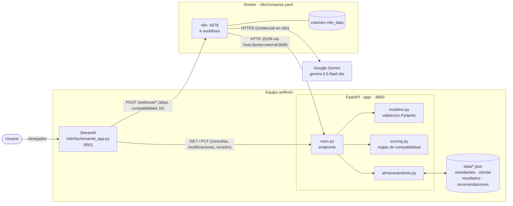
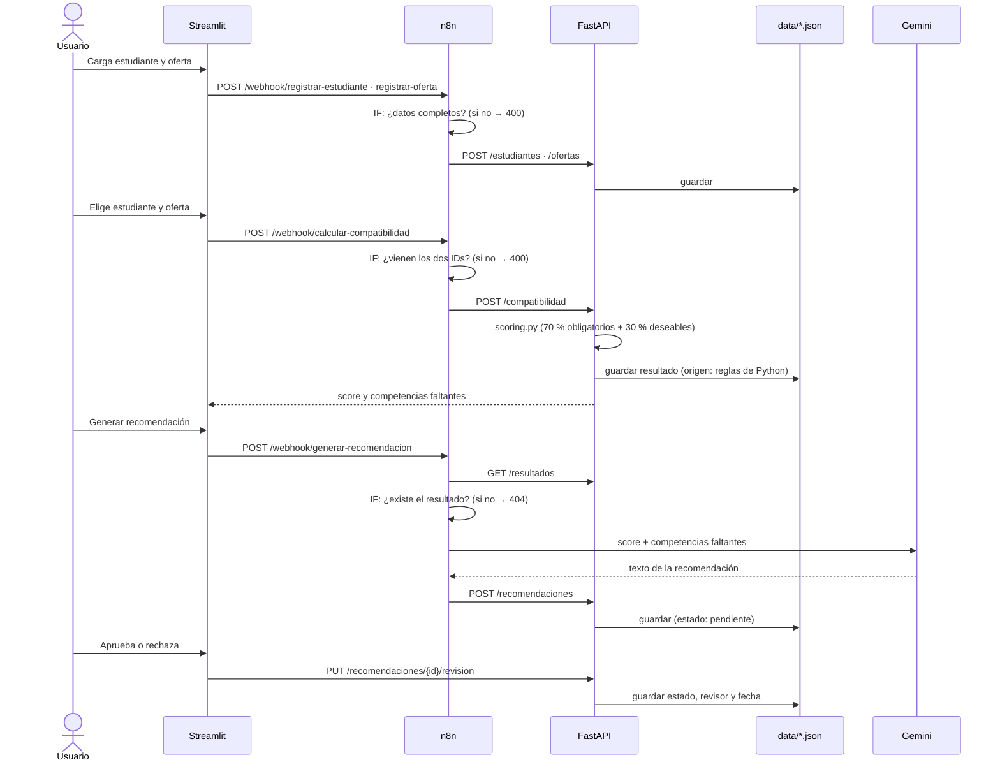

# Arquitectura de Nextia

## 1. Diagrama general

**Separación de responsabilidades**

- **Streamlit** solo muestra y envía datos. No calcula nada.
- **n8n** orquesta los procesos automáticos: valida la entrada con nodos `IF`, llama a la API y a la IA, y responde con el código HTTP correspondiente.
- **FastAPI** es la única puerta a los datos. Valida con Pydantic, aplica las reglas de `scoring.py` y persiste en JSON.
- **Gemini** solo redacta recomendaciones a partir de resultados ya calculados. Sus respuestas quedan `pendiente` hasta que una persona las revisa.

## 2. Puertos y servicios

| Servicio | Dónde corre | Puerto | URL |
|---|---|---|---|
| Streamlit | Equipo anfitrión (venv) | 8501 | http://localhost:8501 |
| FastAPI | Equipo anfitrión (venv) | 8000 | http://127.0.0.1:8000 · Swagger en `/docs` |
| n8n | Contenedor Docker `nextia-n8n` | 5678 → 5678 | http://localhost:5678 |
| Gemini | Servicio externo de Google | 443 (HTTPS) | Configurado como credencial en n8n |

- n8n corre dentro de Docker, así que no puede usar `127.0.0.1` para llegar a la API: ese sería el propio contenedor. Por eso los workflows usan `http://host.docker.internal:8000`, y `compose.yaml` define `extra_hosts: host.docker.internal:host-gateway` para que ese nombre resuelva al equipo anfitrión.
- Para que la API acepte conexiones que vienen del contenedor, conviene iniciarla con `--host 0.0.0.0`.
- La configuración y los workflows de n8n se guardan en el volumen `n8n_data`, así que sobreviven a `docker compose down`.
- La interfaz permite cambiar las URLs de la API y de n8n con las variables `NEXTIA_API_URL` y `NEXTIA_N8N_URL`.

## 3. Comunicación entre componentes

| Origen | Destino | Operación | Para qué |
|---|---|---|---|
| Streamlit | n8n | `POST /webhook/registrar-estudiante` | Alta de estudiante |
| Streamlit | n8n | `POST /webhook/registrar-oferta` | Alta de oferta |
| Streamlit | n8n | `POST /webhook/calcular-compatibilidad` | Calcular score |
| Streamlit | n8n | `POST /webhook/generar-recomendacion` | Recomendación con IA |
| Streamlit | FastAPI | `GET /estudiantes`, `GET /ofertas`, `GET /resultados`, `GET /recomendaciones` | Listados |
| Streamlit | FastAPI | `PUT /estudiantes/{id}`, `PUT /ofertas/{id}` | Modificaciones |
| Streamlit | FastAPI | `PUT /recomendaciones/{id}/revision` | Revisión humana |
| n8n | FastAPI | `POST /estudiantes`, `POST /ofertas` | Persistir altas validadas |
| n8n | FastAPI | `POST /compatibilidad` | Calcular y guardar resultado |
| n8n | FastAPI | `GET /resultados`, `POST /recomendaciones` | Leer resultado y guardar la recomendación |
| n8n | Gemini | Basic LLM Chain | Generar el texto de la recomendación |
| FastAPI | `data/*.json` | `almacenamiento.leer()` / `guardar()` | Persistencia |

Todo el intercambio es **JSON sobre HTTP**.

## 4. Recorrido del proceso principal

