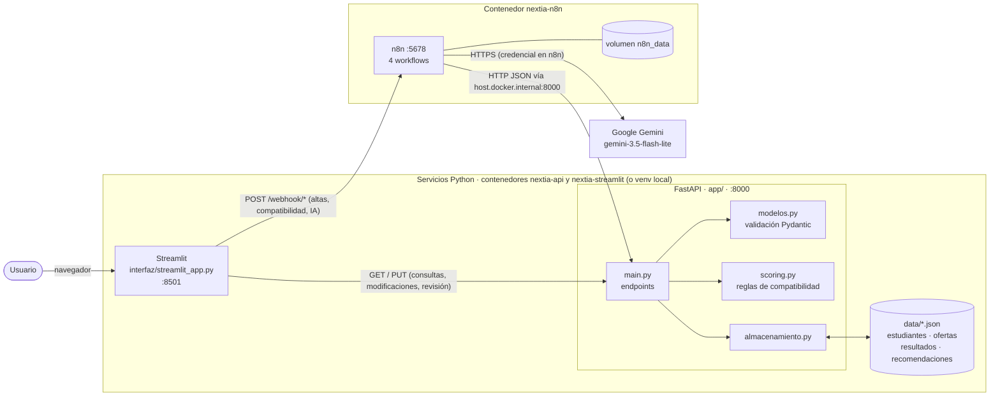
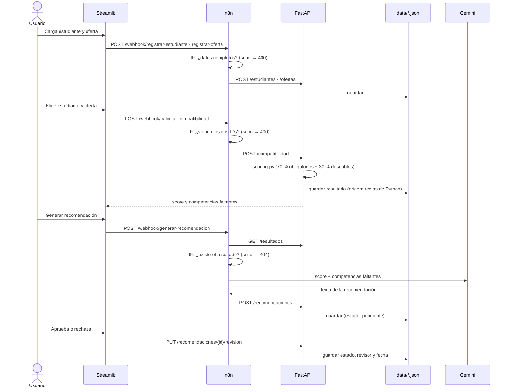

# Arquitectura de Nextia

## 1. Diagrama general

**Separación de responsabilidades**

- **Streamlit** solo muestra y envía datos. No calcula nada.
- **n8n** orquesta los procesos automáticos: valida la entrada con nodos `IF`, llama a la API y a la IA, y responde con el código HTTP correspondiente.
- **FastAPI** es la única puerta a los datos. Valida con Pydantic, aplica las reglas de `scoring.py` y persiste en JSON.
- **Gemini** solo redacta recomendaciones a partir de resultados ya calculados. Sus respuestas quedan `pendiente` hasta que una persona las revisa.

## 2. Puertos y servicios

El sistema se puede ejecutar de dos formas (ver README):

| Servicio | Con `compose.yaml` (todo en Docker) | Con `n8n/compose.yaml` (desarrollo local) | Puerto | URL |
|---|---|---|---|---|
| Streamlit | Contenedor `nextia-streamlit` | venv local | 8501 | http://localhost:8501 |
| FastAPI | Contenedor `nextia-api` | venv local | 8000 | http://localhost:8000 · Swagger en `/docs` |
| n8n | Contenedor `nextia-n8n` | Contenedor `nextia-n8n` | 5678 | http://localhost:5678 |
| Gemini | Servicio externo de Google | ídem | 443 (HTTPS) | Credencial configurada en n8n |

- **Streamlit → servicios:** en Docker Compose, Streamlit usa los nombres de servicio de la red interna: `API_URL=http://api:8000` y `N8N_URL=http://n8n:5678/webhook`. En local usa `127.0.0.1` por defecto. Las dos variables permiten cambiarlo.
- **n8n → API:** en los dos modos los workflows usan `http://host.docker.internal:8000`. Esa URL llega al puerto 8000 publicado en el equipo anfitrión, ya sea el del contenedor `nextia-api` o el de uvicorn local. `extra_hosts: host.docker.internal:host-gateway` hace que ese nombre resuelva al anfitrión. En local, conviene iniciar uvicorn con `--host 0.0.0.0` para que acepte esas conexiones.
- **Persistencia:** `data/` se monta como volumen en `nextia-api`, así que los JSON del repositorio son los mismos en los dos modos. La configuración, los workflows y las credenciales de n8n se guardan en un volumen de Docker y sobreviven a `docker compose down`.

## 3. Comunicación entre componentes

| Origen | Destino | Operación | Para qué |
|---|---|---|---|
| Streamlit | n8n | `POST /webhook/registrar-estudiante` | Alta de estudiante |
| Streamlit | n8n | `POST /webhook/registrar-oferta` | Alta de oferta |
| Streamlit | n8n | `POST /webhook/calcular-compatibilidad` | Calcular score |
| Streamlit | n8n | `POST /webhook/generar-recomendacion` | Recomendación con IA |
| Streamlit | FastAPI | `GET /estudiantes`, `GET /ofertas`, `GET /resultados`, `GET /recomendaciones` | Listados |
| Streamlit | FastAPI | `PUT /estudiantes/{id}`, `PUT /ofertas/{id}` | Modificaciones |
| Streamlit | FastAPI | `PUT /recomendaciones/{id}/revision` | Revisión humana |
| n8n | FastAPI | `POST /estudiantes`, `POST /ofertas` | Persistir altas validadas |
| n8n | FastAPI | `POST /compatibilidad` | Calcular y guardar resultado |
| n8n | FastAPI | `GET /resultados`, `POST /recomendaciones` | Leer resultado y guardar la recomendación |
| n8n | Gemini | Basic LLM Chain | Generar el texto de la recomendación |
| FastAPI | `data/*.json` | `almacenamiento.leer()` / `guardar()` | Persistencia |

Todo el intercambio es **JSON sobre HTTP**.

## 4. Recorrido del proceso principal

